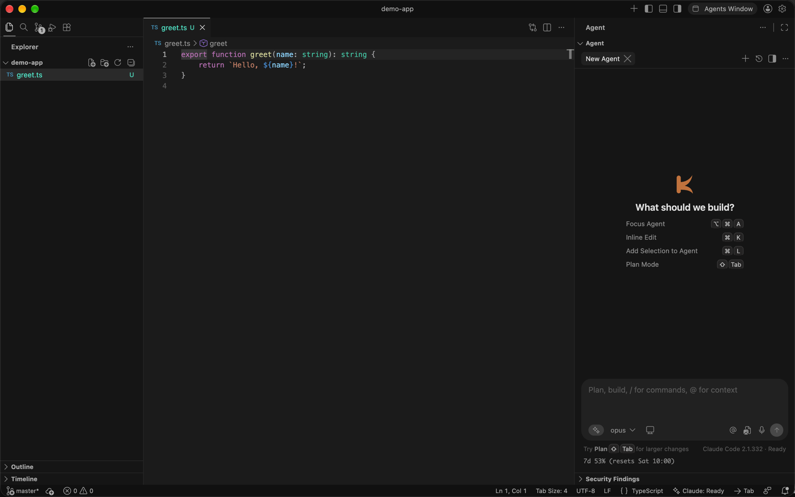

# Klawly

Klawly is a desktop IDE with Claude Code built in. The agent is part of the workbench, not an extension, a webview or a terminal tab. It works with your own Claude Code: Klawly drives the `claude` command you already have installed and signed in.

Klawly is a fork of [Code - OSS](https://github.com/microsoft/vscode), so editing, extensions, terminals and git work the way you expect.

> Klawly is an independent project, not affiliated with or endorsed by Anthropic. Claude and Claude Code are trademarks of Anthropic, PBC.



- [FEATURES.md](FEATURES.md): what Klawly adds
- [KLAWLY_MASTER_PLAN.md](KLAWLY_MASTER_PLAN.md): the build spec

## Requirements

[Claude Code](https://docs.claude.com/en/docs/claude-code) installed and signed in (run `claude` once in a terminal). Klawly does not ship or bundle it.

## Install

Builds are on the [Releases](https://github.com/MehdiMamas/klawly-ide/releases) page. The macOS build is signed and notarized. Windows and Linux builds are not published yet; build them from source for now (see below). They are unsigned, so the OS warns on first launch.

- **macOS (Apple silicon):** open `Klawly-darwin-arm64-<version>.dmg` and drag Klawly onto Applications.
- **Windows (x64):** run `KlawlyUserSetup-x64-<version>.exe` (this user only) or `KlawlySetup-x64-<version>.exe` (all users), or extract the archive and run `Klawly.exe`. When SmartScreen warns, choose More info, then Run anyway.
- **Linux (ARM64):**

  ```bash
  tar -xzf Klawly-linux-arm64-<version>.tar.gz
  ./Klawly-linux-arm64/klawly
  ```

## The `klawly` command

Open files or folders from a terminal, like any editor CLI:

```bash
klawly .                 # open the current folder
klawly path/to/file.ts   # open a file
klawly --help            # all options
```

On macOS, run "Shell Command: Install 'klawly' command in PATH" from the Command Palette.

## Build from source

Node `24.18.0` (see `.nvmrc`).

```bash
npm install
npm run watch
```

Then, in a second terminal, from the repository root:

- **macOS / Linux:** `./scripts/code.sh` (macOS needs the Xcode Command Line Tools: `xcode-select --install`)
- **Windows:** `.\scripts\code.bat` (if it fails on missing `.node` bindings, run `npm rebuild`)

The first launch downloads Electron into `.build/electron`.

## Contributing

See [CONTRIBUTING.md](CONTRIBUTING.md) and the [Code of Conduct](CODE_OF_CONDUCT.md). Report security problems as described in [SECURITY.md](SECURITY.md).

## License

[MIT](LICENSE.txt). The editor base is Code - OSS, copyright Microsoft Corporation; Klawly's changes are copyright Klawly contributors, under the same license.
